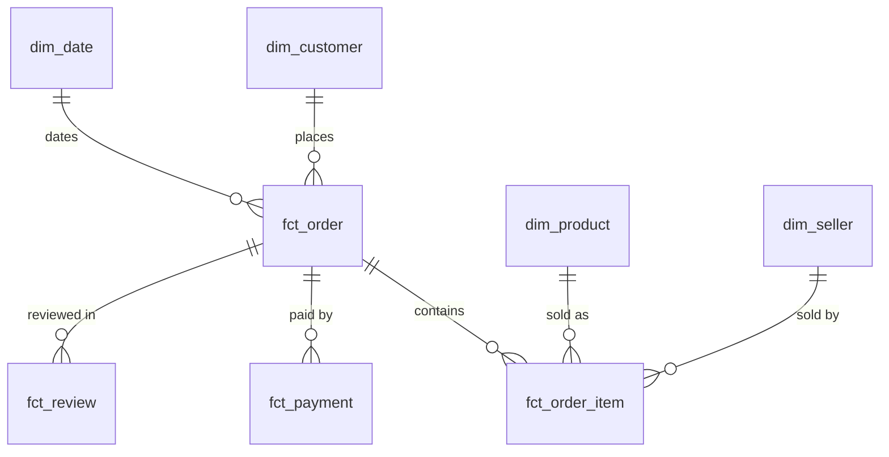

# E-commerce Analytics Warehouse

A SQL Server data warehouse built from about 100,000 real orders on Olist, a Brazilian e-commerce marketplace (2016–2018). It turns nine raw CSV files into a tested star schema. That schema is used to analyse revenue, repeat customers, seller performance and delivery.

## Business questions

- What drives monthly revenue, and how much of what customers pay is freight?
- How do repeat customers differ from one-time buyers?
- Which sellers deliver late, and how does late delivery affect review scores?
- Which product categories sell most, and which receive the worst reviews?
- Do payments reconcile to item prices plus freight for every order?

## Project status

| Step | Work | Status |
|---|---|---|
| 1 | Setup, raw load and load checks | Done |
| 2 | Staging and data profiling | Done |
| 3 | Star schema (dimensions and facts) | Done |
| 4 | Business analysis queries | Next |
| 5 | Reconciliation controls and dashboard | Planned |

## Architecture

| Schema | Purpose |
|---|---|
| `raw` | The source CSV files loaded exactly as they are, with every column stored as text |
| `stg` | Cleaned, typed and renamed copies of the raw tables |
| `dw` | Star schema: dimensions and facts with documented grains |
| `mart` | Summary tables for reporting |
| `audit` | Load history, and the expected record count and checksum of every source file |

Each layer is tested before the next one is built, and the build stops at the first failure:

- **Raw:** every table's row count must match [`data/source_manifest.csv`](data/source_manifest.csv), which counts each file's records independently with Python's CSV parser.
- **Staging:** every table must have the same number of rows as its raw table. No value may be lost when text is converted to numbers and dates, and every money column must add up to the same total. Statuses, payment types, scores, states, IDs and ZIP prefixes must hold only accepted values.
- **Warehouse:** every fact must have as many rows as its staging source. Order-level totals must equal the sums of the item and payment rows, which proves no join repeated a row. The customer history must have one current version per customer, with no gaps or overlaps, and every order must link to the location it was placed from. All foreign keys must be enforced and trusted.

## Data model

A star schema with four facts and four dimensions. Customer location is kept as history (slowly changing dimension, Type 2), so each order is credited to where the customer lived when they ordered. Grains, keys and measures are in [`docs/data_model.md`](docs/data_model.md).



| Table | One row per |
|---|---|
| `fct_order` | Order, with item, payment and review totals |
| `fct_order_item` | Item in an order |
| `fct_payment` | Payment towards an order |
| `fct_review` | Review of an order |
| `dim_customer` | Customer per location they ordered from |
| `dim_product` | Product, with its English category |
| `dim_seller` | Seller |
| `dim_date` | Calendar day |

## Data quality

The staging tables were profiled for missing values, duplicate keys, orphaned rows, out-of-order timestamps and implausible values. The full results are in [`docs/data_profile.md`](docs/data_profile.md), and how each issue is handled is in [`docs/assumptions.md`](docs/assumptions.md). Highlights:

- `customer_id` is created fresh for every order: 99,441 IDs belong to 96,096 people. Repeat customers can only be found through `customer_unique_id`, and 3.1% of customers ordered more than once.
- 789 reviews are attached to several orders, and 547 orders have several reviews, 202 of them with conflicting scores.
- Geolocation lists each ZIP prefix about 53 times, with inconsistent city spellings and 47 points outside Brazil. Joining it directly would multiply rows.
- Payments match items plus freight to within R$0.01 for 98,362 of 98,665 orders. Most of the exceptions were paid in instalments.
- Order volumes are complete from January 2017 to August 2018. The months on either side hold only 349 orders in total.

## How to run

**Requirements:** Windows, SQL Server 2017 or later (LocalDB, Express or Developer edition), `sqlcmd`, Python 3.8 or later.

```
python scripts/get_data.py
powershell -ExecutionPolicy Bypass -File scripts\build.ps1
```

The build uses SQL Server LocalDB by default. To use another instance:

```
powershell -ExecutionPolicy Bypass -File scripts\build.ps1 -Server "localhost\SQLEXPRESS"
```

The build can be rerun at any time. It replaces the data rather than duplicating it, and it keeps the load history in `audit.load_log`.

`BULK INSERT` reads files from the SQL Server machine, so the server must be able to see the project folder. That's always true for LocalDB and for a local instance.

To run the scripts in SSMS instead, open them in the order listed in [`scripts/build.ps1`](scripts/build.ps1). In `sql/01_raw/03_run_load.sql`, replace `$(DataDir)` with the full path to the `data` folder.

The queries in `profiling/` are not part of the build. Open them in SSMS after a build to explore the data.

## Repository structure

```text
data/
  README.md              source, licence and notes on the files
  source_manifest.csv    expected size, checksum and record count of each file
  raw/                   CSV files (downloaded, not committed)
scripts/
  get_data.py            downloads and verifies the source files
  build.ps1              runs every SQL script in order and stops on the first error
sql/
  00_setup/              database, schemas and audit tables
  01_raw/                raw tables and the load procedure
  02_staging/            typed staging tables, their load procedure and a column profiler
  03_warehouse/          star schema tables and their load procedure
tests/
  01_raw_load_checks.sql row counts reconciled to the source files
  02_staging_checks.sql  staging reconciled to raw, plus accepted values and formats
  03_warehouse_checks.sql facts reconciled to staging, customer history, business rules
profiling/               data profiling queries (keys, relationships, timestamps, values, customers)
docs/
  data_profile.md        profiling results
  assumptions.md         how each data issue is handled, and the business definitions
  data_model.md          star schema: diagram, grains, keys, measures
```

## Data source

[Brazilian E-Commerce Public Dataset by Olist](https://www.kaggle.com/datasets/olistbr/brazilian-ecommerce), licensed under CC BY-NC-SA 4.0. See [`data/README.md`](data/README.md) for the files and their quirks.
