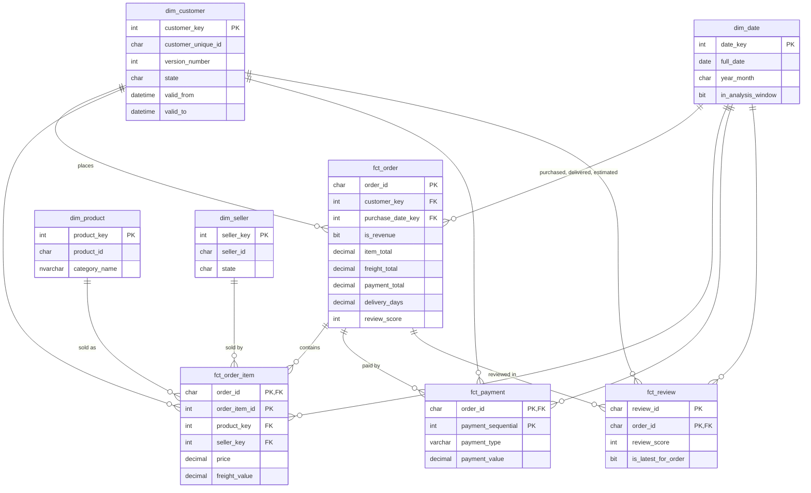

# Data model

The warehouse is a star schema in the `dw` schema. Facts hold the events and their measures (orders, items, payments, reviews); dimensions describe who, what, where and when.

## Tables and grain

| Table | One row per | Primary key | Rows |
|---|---|---|---:|
| `dim_date` | Calendar day, 2016–2018 | `date_key` (yyyymmdd) | 1,096 |
| `dim_customer` | Customer per location they ordered from | `customer_key` | 96,355 |
| `dim_product` | Product | `product_key` | 32,951 |
| `dim_seller` | Seller | `seller_key` | 3,095 |
| `fct_order` | Order | `order_id` | 99,441 |
| `fct_order_item` | Item in an order | `order_id`, `order_item_id` | 112,650 |
| `fct_payment` | Payment towards an order | `order_id`, `payment_sequential` | 103,886 |
| `fct_review` | Review of an order | `review_id`, `order_id` | 99,224 |

Every fact row has exactly one staging source row: the warehouse checks prove the row counts and money totals match.

## Keys

- **Surrogate keys** (`customer_key`, `product_key`, `seller_key`) are integers assigned by the warehouse with `ROW_NUMBER()`, so rebuilding from the same data gives the same keys. The source IDs are kept alongside (`customer_unique_id`, `product_id`, `seller_id`).
- **`date_key`** is the date as a number in `yyyymmdd` form (20170315), which is readable and sorts correctly.
- **`order_id`** stays on every fact as a *degenerate dimension*: an identifier with no attributes of its own, used to group or link rows.
- All 15 foreign keys are enforced and trusted. A fact row can't point to a dimension row that doesn't exist.

## Customer history (slowly changing dimension, Type 2)

`dim_customer` keeps a new row (version) every time a customer orders from a different ZIP prefix, city or state. Of the 96,096 customers, 252 have more than one version, for 96,355 rows in total. Each version is valid from the first purchase at that location until the next version starts. The current version runs to `9999-12-31`.

For example, customer `3e43e6105506432c953e165fb2acf44c` moved three times and then returned to their first ZIP prefix:

| version | zip_code_prefix | valid_from | valid_to | is_current |
|---:|---|---|---|---:|
| 1 | 11701 | 2017-09-18 18:53:15 | 2017-12-01 09:30:36 | 0 |
| 2 | 11700 | 2017-12-01 09:30:36 | 2018-01-11 10:56:15 | 0 |
| 3 | 11704 | 2018-01-11 10:56:15 | 2018-02-12 10:12:54 | 0 |
| 4 | 11701 | 2018-02-12 10:12:54 | 9999-12-31 23:59:59 | 1 |

Each order is linked to the version that was valid at the moment it was purchased, so regional analysis uses where the customer was at the time. The warehouse checks confirm that every order's customer version has the same location as the order's source record.

## Where each decision is applied

Each decision in [`assumptions.md`](assumptions.md) is applied in one place and marked "Decision n" in [`02_create_load_procedure.sql`](../sql/03_warehouse/02_create_load_procedure.sql).

| Decision | Column |
|---|---|
| 2. Revenue counts delivered orders only | `fct_order.is_revenue`, copied to `fct_order_item.is_revenue` |
| 3. Monthly trends use Jan 2017 – Aug 2018 | `dim_date.in_analysis_window` |
| 5. Customer location history | `dim_customer` versions |
| 6. Latest review gives the order's score | `fct_review.is_latest_for_order`, `fct_order.review_score` |
| 8. Category translations and `unknown` | `dim_product.category_name` |
| 9. One location per ZIP prefix | `latitude`, `longitude` on `dim_customer` and `dim_seller` |
| 10. Delivery time is purchase to delivery | `fct_order.delivery_days`, `days_late`, `is_late` |

## Measures

| Measure | Table | Definition |
|---|---|---|
| Revenue | `fct_order_item` | `SUM(price) WHERE is_revenue = 1` |
| Freight | `fct_order_item` | `SUM(freight_value)`; kept separate from revenue |
| Orders | `fct_order` | `COUNT(*)` |
| Average order value | `fct_order` | `AVG(item_total) WHERE is_revenue = 1` |
| Payments collected | `fct_payment` | `SUM(payment_value)` |
| Delivery days | `fct_order` | Days from purchase to delivery to the customer, with decimals |
| Late delivery | `fct_order` | Delivered on a later date than the estimated delivery date |
| Review score | `fct_order` | Score of the most recently answered review |

## Marts

Summary tables in the `mart` schema, built from `dw` for dashboards ([`sql/04_marts`](../sql/04_marts)). Each one reconciles to the warehouse (`tests/04_mart_checks.sql`).

| Mart | One row per | Rows | Use |
|---|---|---:|---|
| `monthly_performance` | Purchase month | 25 | Trends: revenue, orders, average order value, new customers, delivery, reviews |
| `state_monthly` | Month and customer state | 556 | Map and regional comparison; includes state name and region |
| `category_monthly` | Month and product category | 1,273 | Category ranking and review scores, filterable by month |
| `seller_performance` | Seller | 3,095 | Seller league table, late-rate deciles |
| `customer_summary` | Customer (`customer_unique_id`) | 96,096 | Repeat purchase, time to second order, first-order experience |
| `delivery_review` | Arrival bucket (early to 8+ days late) | 7 | How lateness affects review scores |

### Building measures from marts

Marts store **sums and counts**, so averages and percentages stay correct at any level of a dashboard:

| Measure | Formula |
|---|---|
| Average order value | `SUM(revenue) / SUM(delivered_orders)` |
| Freight share | `SUM(freight) / (SUM(revenue) + SUM(freight))` |
| Late rate | `SUM(late_orders) / SUM(delivered_with_date)` |
| Average delivery days | `SUM(delivery_days_sum) / SUM(delivered_with_date)` |
| Average review score | `SUM(review_score_sum) / SUM(reviewed_orders)` |
| On-time review score | `SUM(on_time_review_score_sum) / SUM(on_time_reviewed_orders)` |

Averaging a ratio column across rows gives the wrong answer: a month with 750 orders would count as much as one with 7,000. Ratio columns are provided only where a row is shown on its own (one month, seller, customer or bucket).

**Columns that can't be summed across rows:**
- `monthly_performance.customers`: someone who orders in two months counts in both. `new_customers` *can* be summed.
- `category_monthly.orders`: an order with items from two categories counts in both. Total orders come from `monthly_performance`.
- `seller_performance.delivered_orders`: the same reason, for multi-seller orders.

## Querying rules

- **Revenue:** filter `is_revenue = 1`.
- **Monthly trends:** filter `dim_date.in_analysis_window = 1`.
- **Customer counts:** count `DISTINCT customer_unique_id` from `dim_customer`, not `customer_key`. A customer who moved has several keys.
- **Don't join `fct_order_item` to `fct_payment` directly.** Both have several rows per order, so the join repeats rows. Use the order-level totals in `fct_order`.
